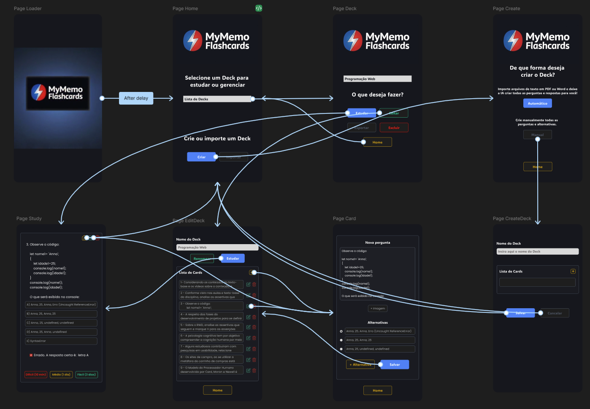

# 🗂️ MyMemo Flashcards - O que é e propósito

MyMemo é um web-app responsivo de repetição espaçada para microaprendizagem baseado em flashcards. 
Para uso da comunidade de forma geral, inclusive podendo ser utilizado como ferramenta para minimizar os efeitos do mal de Alzheimer, contudo o app foi desenvolvido com foco em indivíduos que necessitam estudar e reter conteúdo para fins de aprendizagem, incluindo estudantes de idiomas, de ensino regular, ensino superior e concursos públicos, capaz de auxiliar pessoas na memorização e revisão sistemática de conteúdos educacionais, a fim de melhorar os índices de educação da população.

## 🚀 Versões do software

Seguindo as boas práticas de mercado e cultura de desenvolvimento ágil como SCRUM, essa aplicação foi dividida em dois projetos, um primeiro usando localStorage e posteriormente outra versão sendo fullstack, contendo demais módulos. 

## Primeira versão - usando localStorage

Esta apresenta uma versão mais simples da aplicação e foi a primeira versão publicada do app, `desenvolvida com intuito de permitir a execução de testes manuais por alguns usuários e a devolução de feedbacks para evolução da ferramenta`.

Por ser uma versão inicial, esta versão está sem os módulos de criação de decks e edição de cards, porém apresenta o layout do software e funcionalidades de estudar, editar decks, importar e exportar decks.

`Ela fica hospedada no GitHub Pages e usa o localStorage` do navegador para persistência de dados com JSON file, ou seja, se o navegador for "limpo" tudo que não foi exportado será perdido. Esta versão também não possibilita que o histórico de estudos seja acessado por diferentes dispositivos, uma vez que os dados ficam salvos localmente em cada dispositivo.

Uma versão (release) do app foi lançada e implementada via GitHub Actions, contendo os principais módulos da aplicação. Curte lá!

https://Charles-da-silva.github.io/MyMemo_ReactAndTypescript

## Segunda versão - aplicação fullstack

`A versão fullstack teve como base o primeiro projeto, mas ganhou outros módulos como criação de decks de forma manual ou usando IA, assim como o módulo de edição de cards`. Essa versão também já encontra-se publicada e possui todos os módulos de estudos prontos, incluindo criação (manual e automatizada via IA), edição, exclusão, importação e exportação de decks e cards.

### Tecnologias utilizadas nesta versão

- HTML, CSS, React e TypeScript (frontend)
- Node.js (backend)
- PostgreSQL (banco de dados)
- Vercel (para hospedar o frontend)
- Render (para hospedar o backend)
- Neon (para hospedar o banco de dados)
- GitHub Actions
- Configurado domínio próprio para a versão fullstack

### Funcionalidades

- **Gerenciamento de decks:** criação, edição e exclusão de baralhos.
- **Criação de cards:** adição de perguntas com suporte a múltiplas alternativas.
- **Utilização de IA:** por ser um projeto de baixo custo, cheguei a implementar integração com APIs de IAs, mas concluí que os créditos de versões free não seriam suficientes para criação dos decks, então encontrei solução na funcionalidade a qual disponibiliza um prompt completo para que o usuário possa usar em chatbots de IAs para criação de decks no formato JSON estruturado exatamente como o banco precisa, somente usando o prompt e importando um arquivo de texto que contenha o assunto desejado, possibilitando assim a criação automatizada de decks de estudos personalizados, minimizando o esforço quando comparado com a criação manual.
- **Sistema de revisão e foco nas maiores dificuldades:** algoritmo de repetição espaçada que apresenta ao usuário o que ele deve estudar, baseado na classificação de dificuldade que a própria pessoa faz das perguntas, conforme vai estudando, existindo três classificações de dificuldade:
  - **Difícil:** revisa em 10 minutos.
  - **Médio:** revisa em 1 dia.
  - **Fácil:** revisa em 3 dias.
- **Exclusão em tempo real:** opção de excluir uma pergunta diretamente durante a sessão de estudos.
- **Persistência de dados:** na versão fullstack, os dados são persistidos em PostgreSQL.
- **Exportação e importação de decks:** suporte a arquivos JSON, possibilitando backup e compartilhamento de decks entre usuários.

### Autenticação e configuração

O acesso à versão fullstack usa Google Sign-In pelo Firebase Authentication. O servidor valida o token do Firebase e filtra decks pelo UID do usuário; os cards herdam o acesso do deck.

1. O projeto Firebase `mymemo-flashcards` já está criado, com Google habilitado em **Authentication > Sign-in method** e os domínios `charles-da-silva.github.io` e `mymemo.nanuvem.net` autorizados. Para novos hosts de produção, adicione o domínio em **Authentication > Settings > Authorized domains**.
2. Copie `Frontend/.env.example` para `Frontend/.env.local` e preencha as credenciais de configuração do app web Firebase. Defina `VITE_API_URL` para a URL do backend.
3. Configure `FIREBASE_SERVICE_ACCOUNT` no ambiente do backend como o JSON de uma chave de conta de serviço do mesmo projeto Firebase. Nunca publique essa chave.
4. Configure `DATABASE_URL` no backend ou os campos `DATABASE_HOST`, `DATABASE_PORT`, `DATABASE_USER`, `DATABASE_PASSWORD` e `DATABASE_NAME`, e faça o deploy. O servidor cria a tabela de usuários e adiciona `owner_id` aos decks automaticamente. No primeiro login, a primeira conta registrada recebe os decks antigos sem proprietário.
5. Para o deploy do GitHub Pages, cadastre os segredos do repositório `VITE_FIREBASE_API_KEY`, `VITE_FIREBASE_AUTH_DOMAIN`, `VITE_FIREBASE_PROJECT_ID` e `VITE_FIREBASE_APP_ID`. A URL da API pode ser definida na variável de repositório `VITE_API_URL`; por padrão, usa o backend do Render. Cadastre também o domínio publicado nos domínios autorizados do Firebase.

Use `Frontend/.env.example` e `Backend/.env.example` como modelos, sem substituir valores de produção por exemplos.

### Quer testar a versão fullstack do app?

Dá uma conferida como está a versão atual da aplicação!

https://mymemo.nanuvem.net/

 

### Link e telas do protótipo inicial no Figma

https://mymemoflashcards.short.gy/Figma

   
  

